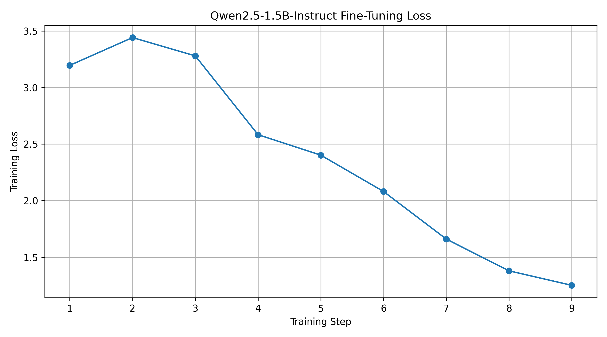

# QLoRA Fine-Tuning: Natural Language to SQL

## Project Overview
This project fine-tunes the Qwen2.5-1.5B-Instruct open-weight language model using QLoRA to convert natural-language questions into SQL queries.

## Objective
Generate SQL queries from plain-English questions for database operations such as filtering, sorting, counting, and aggregation.

## Technology Stack
- Python
- Google Colab
- NVIDIA Tesla T4 GPU
- Qwen2.5-1.5B-Instruct
- Unsloth
- Hugging Face Transformers
- PEFT and LoRA
- 4-bit quantization

## Fine-Tuning Configuration
- Method: QLoRA
- LoRA rank: 8
- LoRA alpha: 16
- Maximum sequence length: 2048
- Training examples: 20 synthetic examples
- Training steps: 9

## Training Results
Training loss decreased overall from approximately 3.196 to 1.251.

## Model Evaluation

The base and fine-tuned models were tested on five illustrative SQL questions.

| Model | Exact Matches | Exact-Match Score |
|---|---:|---:|
| Base Model | 3/5 | 60% |
| Fine-Tuned Model | 5/5 | 100% |

**Note:** The evaluation set is very small and intended only as a demonstration. These results do not establish general model accuracy. Exact-match evaluation may also mark logically equivalent SQL as incorrect.

## Fine-Tuned Adapter

The LoRA adapter is hosted on Hugging Face:

[View Qwen SQL QLoRA Adapter](https://huggingface.co/JeevarthananA/qwen2.5-1.5b-sql-qlora)

## Repository Files
- `Task02_Qwen_SQL_QLoRA.ipynb` — Fine-tuning notebook
- `base_vs_finetuned.csv` — Base versus fine-tuned model outputs
- `sql_evaluation_results.csv` — Evaluation results
- `training_loss.png` — Training loss graph

## Limitations
- The training dataset contains only 20 synthetic examples.
- Evaluation uses only five test questions.
- More training data and a larger independent test set are needed to assess generalization.
- Generated SQL should be validated before use with a real database.

## Internship
SkillCraft Technology — AI Engineer Internship
